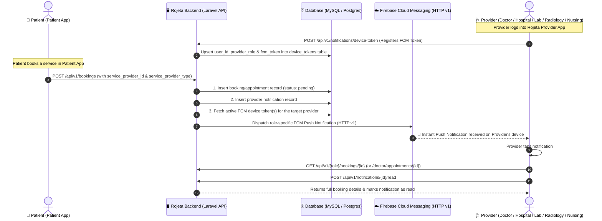

# Backend Specification: Healthcare Provider Push Notifications & Patient Booking Flow (All Roles)

## 1. Executive Summary

This document specifies the backend requirements for sending **real-time Firebase Cloud Messaging (FCM) push notifications** to **all healthcare provider roles** in the **Provider Application (`rojeta_doctor`)** whenever a patient submits a booking from the **Patient Mobile Application (`rojeta-patient`)**.

The Provider Application supports **5 distinct provider roles**:

1. 🩺 **Doctor (`doctor`)**: Clinic consultations, video calls, phone consultations, home visits.
2. 🏥 **Hospital (`hospital`)**: Hospital admissions, ICU beds, NICU incubators, Ambulance requests.
3. 🧪 **Laboratory (`laboratory` / `lab`)**: Diagnostic tests and home sample collection.
4. 🩻 **Radiology Center (`radiology`)**: Imaging, X-Ray, MRI, CT scans, and Ultrasound.
5. 👩‍⚕️ **Nursing Care (`nursing`)**: In-home nursing care, injections, wound dressing, and post-operative monitoring.

---

## 2. End-to-End System Workflow



---

## 3. Provider App: Device Token Management API (All Roles)

All provider accounts register their device token with the backend upon login and on token refresh.

### 3.1. Register / Update Device Token

- **Endpoint:** `POST /api/v1/notifications/device-token` *(Aliases: `POST /api/v1/doctor/device-token`, `POST /api/v1/provider/device-token`)*
- **Authentication:** `Bearer <provider_auth_token>`
- **Headers:**
  - `Accept: application/json`
  - `Content-Type: application/json`

#### Request Body

```json
{
  "token": "dK9s_Example_FCM_Token_String_Generated_By_Firebase_Messaging...",
  "device_type": "android",
  "device_id": "8f3b6c21-9981-4882-901b-c743818e90bb",
  "app_version": "1.0.0"
}
```

| Parameter | Type | Required | Description |
| :--- | :--- | :--- | :--- |
| `token` | `string` | **Yes** | Firebase Cloud Messaging device registration token |
| `device_type` | `string` | **Yes** | Device OS: `'android'` or `'ios'` |
| `device_id` | `string` | No | Hardware / vendor device UUID |
| `app_version` | `string` | No | App client version |

#### Response (`200 OK`)

```json
{
  "status": true,
  "message": "Device token registered successfully",
  "data": {
    "user_id": "9b1deb4d-3b7d-4bad-9bdd-2b0d7b3dcb6d",
    "role": "doctor",
    "token": "dK9s_Example_FCM_Token...",
    "device_type": "android",
    "updated_at": "2026-09-21T14:30:00Z"
  }
}
```

---

### 3.2. Delete / Unregister Device Token (On Logout)

- **Endpoint:** `DELETE /api/v1/notifications/device-token` *(Aliases: `DELETE /api/v1/doctor/device-token`)*
- **Authentication:** `Bearer <provider_auth_token>`
- **Headers:** `Accept: application/json`, `Content-Type: application/json`

#### Request Body

```json
{
  "token": "dK9s_Example_FCM_Token..."
}
```

---

## 4. Patient App: Booking Endpoints by Provider Role

The Patient App (`rojeta-patient`) sends bookings using the following standardized schemas:

### 4.1. Doctor Appointment (`service_provider_type: "doctor"`)

- **Endpoint:** `POST /api/v1/bookings`
- **Request Body:**

```json
{
  "service_provider_id": "9b1deb4d-3b7d-4bad-9bdd-2b0d7b3dcb6d",
  "service_provider_type": "doctor",
  "service_id": "1",
  "booking_date": "2026-09-25",
  "booking_time": "16:00",
  "visit_type": "clinic",
  "payment_type": "cash",
  "patient_name": "أحمد محمد علي",
  "patient_phone": "+201012345678",
  "patient_notes": "استشارة بخصوص آلام في الظهر والصدر",
  "address": {
    "street": "شارع النصر، المعادي",
    "area": "المعادي",
    "city": "القاهرة"
  }
}
```

---

### 4.2. Hospital Services (`service_provider_type: "hospital"`)

#### A. ICU Bed Booking

- **Endpoint:** `POST /api/v1/bookings/icu/create` *(Fallback: `POST /api/v1/bookings`)*
- **Request Body:**

```json
{
  "service_provider_id": "hospital_uuid_123",
  "service_provider_type": "hospital",
  "service_type": "icu",
  "patient_name": "محمود إبراهيم",
  "patient_phone": "+201112223334",
  "patient_age": 62,
  "medical_condition": "جلطة حادة وضيق في التنفس",
  "needs_ventilator": true,
  "booking_date": "2026-09-21",
  "payment_type": "cash"
}
```

#### B. NICU Incubator Booking

- **Endpoint:** `POST /api/v1/bookings/nicu/create` *(Fallback: `POST /api/v1/bookings`)*
- **Request Body:**

```json
{
  "service_provider_id": "hospital_uuid_123",
  "service_provider_type": "hospital",
  "service_type": "nicu",
  "baby_name": "مولود أحمد",
  "parent_phone": "+201099887766",
  "gestational_age_weeks": 34,
  "birth_weight_kg": 1.9,
  "booking_date": "2026-09-21"
}
```

#### C. Ambulance Request

- **Endpoint:** `POST /api/v1/bookings/ambulance/create`
- **Request Body:**

```json
{
  "service_provider_id": "hospital_uuid_123",
  "service_provider_type": "hospital",
  "service_type": "ambulance",
  "patient_name": "فاطمة حسن",
  "patient_phone": "+201055556666",
  "pickup_location": {
    "latitude": 30.0444,
    "longitude": 31.2357,
    "address_text": "التجمع الخامس، القاهرة"
  },
  "emergency_type": "critical",
  "payment_type": "cash"
}
```

---

### 4.3. Laboratory Booking (`service_provider_type: "laboratory"`)

- **Endpoint:** `POST /api/v1/bookings/laboratory/create` *(Fallback: `POST /api/v1/bookings`)*
- **Request Body:**

```json
{
  "service_provider_id": "lab_uuid_456",
  "service_provider_type": "laboratory",
  "test_ids": ["12", "15", "89"],
  "test_names": ["صورة دم كاملة CBC", "وظائف كبد", "سكر تراكمي HbA1c"],
  "visit_type": "home_visit",
  "booking_date": "2026-09-22",
  "booking_time": "09:30",
  "patient_name": "سارة طارق",
  "patient_phone": "+201200001111",
  "address": {
    "street": "شارع عباس العقاد",
    "area": "مدينة نصر",
    "city": "القاهرة"
  },
  "payment_type": "credit_card"
}
```

---

### 4.4. Radiology Scan Booking (`service_provider_type: "radiology"`)

- **Endpoint:** `POST /api/v1/bookings/radiology/create` *(Fallback: `POST /api/v1/bookings`)*
- **Request Body:**

```json
{
  "service_provider_id": "radiology_uuid_789",
  "service_provider_type": "radiology",
  "scan_ids": ["44"],
  "scan_names": ["رنين مغناطيسي على الفقرات القطنية MRI Lumbar Spine"],
  "visit_type": "center",
  "booking_date": "2026-09-23",
  "booking_time": "14:00",
  "patient_name": "خالد مصطفى",
  "patient_phone": "+201555554444",
  "payment_type": "cash"
}
```

---

### 4.5. Nursing Care Booking (`service_provider_type: "nursing"`)

- **Endpoint:** `POST /api/v1/bookings/nursing/create` *(Fallback: `POST /api/v1/bookings`)*
- **Request Body:**

```json
{
  "service_provider_id": "nursing_uuid_321",
  "service_provider_type": "nursing",
  "service_id": "8",
  "service_name": "رعاية مسنين وجلسات تنفس منزلية",
  "duration_hours": "12",
  "visit_type": "home_visit",
  "booking_date": "2026-09-24",
  "booking_time": "08:00",
  "patient_name": "عبد الرحمن علي",
  "patient_phone": "+201144443333",
  "address": {
    "street": "شارع الهرم الرئيسي",
    "area": "الجيزة",
    "city": "الجيزة"
  },
  "payment_type": "cash"
}
```

---

## 5. FCM Push Notification Specifications by Provider Role

When a booking is created, the backend sends an FCM HTTP v1 message tailored to the provider's role.

### 5.1. Role-Specific Notification Matrix

| Role | `service_provider_type` | `type` (data payload) | Notification Title (Arabic / English) | App Target Route |
| :--- | :--- | :--- | :--- | :--- |
| 🩺 **Doctor** | `doctor` | `"new_appointment"` | `حجز موعد جديد 🩺` / `New Appointment` | `/doctor/appointments/details` |
| 🏥 **Hospital (ICU)** | `hospital` | `"new_icu_booking"` | `طلب حجز سرير رعاية مركزة 🛏️` / `New ICU Bed Request` | `/hospital/icu-bookings/details` |
| 🏥 **Hospital (NICU)** | `hospital` | `"new_nicu_booking"` | `طلب حجز حضانة أطفال 👶` / `New NICU Incubator Request` | `/hospital/nicu-bookings/details` |
| 🏥 **Hospital (Ambulance)** | `hospital` | `"new_ambulance_request"` | `🚨 طلب إسعاف طارئ` / `Emergency Ambulance Request` | `/hospital/ambulance/details` |
| 🧪 **Laboratory** | `laboratory` | `"new_lab_booking"` | `طلب تحليل مختبر جديد 🧪` / `New Lab Test Booking` | `/lab/bookings/details` |
| 🩻 **Radiology** | `radiology` | `"new_radiology_booking"` | `طلب فحص أشعة جديد 🩻` / `New Radiology Scan Booking` | `/radiology/bookings/details` |
| 👩‍⚕️ **Nursing Care** | `nursing` | `"new_nursing_booking"` | `طلب خدمة تمريضية منزلية 👩‍⚕️` / `New Home Nursing Request` | `/nursing/bookings/details` |

---

### 5.2. Role-by-Role FCM HTTP v1 JSON Payloads

#### 1. Doctor Role (`doctor`)

```json
{
  "message": {
    "token": "<doctor_fcm_token>",
    "notification": {
      "title": "حجز موعد جديد 🩺",
      "body": "قام المريض أحمد محمد بحجز موعد جديد معك بتاريخ 25-09-2026 الساعة 04:00 م"
    },
    "data": {
      "role": "doctor",
      "type": "new_appointment",
      "appointment_id": "1052",
      "booking_ref": "ROJ-20260925-1052",
      "patient_name": "أحمد محمد علي",
      "patient_phone": "+201012345678",
      "booking_date": "2026-09-25",
      "booking_time": "16:00",
      "visit_type": "clinic",
      "route": "/doctor/appointments/details",
      "click_action": "FLUTTER_NOTIFICATION_CLICK"
    },
    "android": {
      "priority": "HIGH",
      "notification": {
        "channel_id": "basic_channel",
        "sound": "default",
        "icon": "launcher_icon",
        "color": "#1E88E5",
        "notification_priority": "PRIORITY_MAX",
        "click_action": "FLUTTER_NOTIFICATION_CLICK"
      }
    },
    "apns": {
      "payload": {
        "aps": { "alert": { "title": "حجز موعد جديد 🩺", "body": "قام المريض أحمد محمد بحجز موعد جديد معك" }, "sound": "default", "badge": 1, "content-available": 1 }
      }
    }
  }
}
```

#### 2. Hospital Role (`hospital` - ICU / NICU / Ambulance)

```json
{
  "message": {
    "token": "<hospital_fcm_token>",
    "notification": {
      "title": "🚨 طلب سرير رعاية مركزة عاجل",
      "body": "طلب حجز ICU جديد للمريض محمود إبراهيم (62 سنة) - يحتاج جهاز تنفس"
    },
    "data": {
      "role": "hospital",
      "type": "new_icu_booking",
      "booking_id": "5021",
      "booking_ref": "ICU-20260921-5021",
      "patient_name": "محمود إبراهيم",
      "patient_phone": "+201112223334",
      "medical_condition": "جلطة حادة وضيق في التنفس",
      "needs_ventilator": "true",
      "route": "/hospital/icu-bookings/details",
      "click_action": "FLUTTER_NOTIFICATION_CLICK"
    },
    "android": {
      "priority": "HIGH",
      "notification": {
        "channel_id": "basic_channel",
        "sound": "default",
        "icon": "launcher_icon",
        "color": "#E53935",
        "notification_priority": "PRIORITY_MAX"
      }
    },
    "apns": {
      "payload": {
        "aps": { "alert": { "title": "🚨 طلب سرير رعاية مركزة عاجل", "body": "طلب حجز ICU جديد للمريض محمود إبراهيم" }, "sound": "default", "badge": 1 }
      }
    }
  }
}
```

#### 3. Laboratory Role (`laboratory`)

```json
{
  "message": {
    "token": "<lab_fcm_token>",
    "notification": {
      "title": "طلب تحليل مختبر جديد 🧪",
      "body": "طلب زيارة منزلية لسحب عينة تحاليل للمريضة سارة طارق بتاريخ 22-09-2026"
    },
    "data": {
      "role": "laboratory",
      "type": "new_lab_booking",
      "booking_id": "3104",
      "booking_ref": "LAB-20260922-3104",
      "patient_name": "سارة طارق",
      "patient_phone": "+201200001111",
      "tests_count": "3",
      "visit_type": "home_visit",
      "booking_date": "2026-09-22",
      "booking_time": "09:30",
      "address": "شارع عباس العقاد، مدينة نصر",
      "route": "/lab/bookings/details",
      "click_action": "FLUTTER_NOTIFICATION_CLICK"
    },
    "android": {
      "priority": "HIGH",
      "notification": {
        "channel_id": "basic_channel",
        "sound": "default",
        "icon": "launcher_icon",
        "color": "#43A047"
      }
    }
  }
}
```

#### 4. Radiology Center Role (`radiology`)

```json
{
  "message": {
    "token": "<radiology_fcm_token>",
    "notification": {
      "title": "طلب فحص أشعة جديد 🩻",
      "body": "حجز فحص رنين مغناطيسي MRI للمريض خالد مصطفى بتاريخ 23-09-2026"
    },
    "data": {
      "role": "radiology",
      "type": "new_radiology_booking",
      "booking_id": "4108",
      "booking_ref": "RAD-20260923-4108",
      "patient_name": "خالد مصطفى",
      "patient_phone": "+201555554444",
      "scan_name": "رنين مغناطيسي MRI Lumbar Spine",
      "booking_date": "2026-09-23",
      "booking_time": "14:00",
      "route": "/radiology/bookings/details",
      "click_action": "FLUTTER_NOTIFICATION_CLICK"
    },
    "android": {
      "priority": "HIGH",
      "notification": {
        "channel_id": "basic_channel",
        "sound": "default",
        "icon": "launcher_icon",
        "color": "#8E24AA"
      }
    }
  }
}
```

#### 5. Nursing Care Role (`nursing`)

```json
{
  "message": {
    "token": "<nursing_fcm_token>",
    "notification": {
      "title": "طلب خدمة تمريضية منزلية 👩‍⚕️",
      "body": "طلب تمريض منزلي (12 ساعة) للمريض عبد الرحمن علي بتاريخ 24-09-2026"
    },
    "data": {
      "role": "nursing",
      "type": "new_nursing_booking",
      "booking_id": "6112",
      "booking_ref": "NUR-20260924-6112",
      "patient_name": "عبد الرحمن علي",
      "patient_phone": "+201144443333",
      "service_name": "رعاية مسنين وجلسات تنفس منزلية",
      "duration_hours": "12",
      "booking_date": "2026-09-24",
      "booking_time": "08:00",
      "address": "شارع الهرم الرئيسي، الجيزة",
      "route": "/nursing/bookings/details",
      "click_action": "FLUTTER_NOTIFICATION_CLICK"
    },
    "android": {
      "priority": "HIGH",
      "notification": {
        "channel_id": "basic_channel",
        "sound": "default",
        "icon": "launcher_icon",
        "color": "#00897B"
      }
    }
  }
}
```

---

## 6. Provider Notifications In-App API (All Roles)

### 6.1. Fetch Notifications List

- **Endpoint:** `GET /api/v1/notifications/get` *(Aliases: `GET /api/v1/doctor/notifications`, `GET /api/v1/provider/notifications`)*
- **Authentication:** `Bearer <provider_token>`
- **Query Parameters:** `?page=1&per_page=20`

#### Response (`200 OK`)

```json
{
  "status": true,
  "data": [
    {
      "id": "a5e8f230-8d41-4716-bc34-e42a98f7e2d1",
      "role": "doctor",
      "type": "new_appointment",
      "title": "حجز موعد جديد 🩺",
      "body": "قام المريض أحمد محمد بحجز موعد جديد معك بتاريخ 25-09-2026 الساعة 04:00 م",
      "data": {
        "appointment_id": "1052",
        "booking_ref": "ROJ-20260925-1052",
        "patient_name": "أحمد محمد علي",
        "booking_date": "2026-09-25",
        "booking_time": "16:00",
        "visit_type": "clinic"
      },
      "is_read": false,
      "created_at": "2026-09-21T14:35:10Z"
    }
  ],
  "meta": {
    "unread_count": 3,
    "current_page": 1,
    "total": 15
  }
}
```

---

### 6.2. Mark Notification as Read

- **Endpoint:** `POST /api/v1/notifications/{id}/read` *(Alias: `POST /api/v1/doctor/notifications/{id}/read`)*
- **Authentication:** `Bearer <provider_token>`

---

### 6.3. Mark All Notifications as Read

- **Endpoint:** `POST /api/v1/notifications/read-all` *(Alias: `POST /api/v1/doctor/notifications/read-all`)*
- **Authentication:** `Bearer <provider_token>`

---

## 7. Complete Laravel Backend Implementation Blueprint

### 7.1. Database Migration: `device_tokens`

```php
Schema::create('device_tokens', function (Blueprint $table) {
    $table->id();
    $table->unsignedBigInteger('user_id')->index();
    $table->string('role', 50)->default('doctor')->index(); // doctor, hospital, laboratory, radiology, nursing
    $table->string('token', 500)->unique();
    $table->enum('device_type', ['android', 'ios', 'web'])->default('android');
    $table->string('device_id')->nullable();
    $table->string('app_version')->nullable();
    $table->timestamps();

    $table->foreign('user_id')->references('id')->on('users')->onDelete('cascade');
});
```

---

### 7.2. Universal Notification Dispatcher Listener (`SendProviderBookingNotificationListener.php`)

```php
namespace App\Listeners;

use App\Events\BookingCreatedEvent;
use App\Models\DeviceToken;
use App\Models\Notification;
use App\Services\FirebaseNotificationService;
use Illuminate\Contracts\Queue\ShouldQueue;
use Illuminate\Support\Str;

class SendProviderBookingNotificationListener implements ShouldQueue
{
    protected FirebaseNotificationService $fcmService;

    public function __construct(FirebaseNotificationService $fcmService)
    {
        $this->fcmService = $fcmService;
    }

    public function handle(BookingCreatedEvent $event): void
    {
        $booking = $event->booking;
        $providerId = $booking->service_provider_id ?? $booking->provider_id;
        $providerType = strtolower($booking->service_provider_type ?? $booking->provider_type ?? 'doctor');

        // 1. Construct role-specific Notification Title, Body, and Route
        [$title, $body, $type, $route, $color] = $this->resolveNotificationDetails($booking, $providerType);

        $dataPayload = [
            'role'           => $providerType,
            'type'           => $type,
            'booking_id'     => (string) $booking->id,
            'appointment_id' => (string) $booking->id,
            'booking_ref'    => (string) ($booking->booking_ref ?? $booking->reference_id ?? $booking->id),
            'patient_name'   => (string) ($booking->patient_name ?? 'مريض'),
            'patient_phone'  => (string) ($booking->patient_phone ?? ''),
            'booking_date'   => (string) ($booking->booking_date ?? $booking->date ?? ''),
            'booking_time'   => (string) ($booking->booking_time ?? $booking->time ?? ''),
            'visit_type'     => (string) ($booking->visit_type ?? $booking->location_type ?? 'clinic'),
            'route'          => $route,
            'click_action'   => 'FLUTTER_NOTIFICATION_CLICK',
        ];

        // 2. Persist notification in database
        Notification::create([
            'id'      => (string) Str::uuid(),
            'user_id' => $providerId,
            'role'    => $providerType,
            'type'    => $type,
            'title'   => $title,
            'body'    => $body,
            'data'    => $dataPayload,
            'is_read' => false,
        ]);

        // 3. Fetch active FCM tokens for this provider
        $tokens = DeviceToken::where('user_id', $providerId)->pluck('token')->toArray();

        // 4. Send FCM Push Notification to all active devices
        foreach ($tokens as $token) {
            $this->fcmService->sendPushNotification(
                token: $token,
                title: $title,
                body: $body,
                data: $dataPayload,
                color: $color
            );
        }
    }

    private function resolveNotificationDetails($booking, string $role): array
    {
        $patient = $booking->patient_name ?? 'أحد المرضى';
        $date = $booking->booking_date ?? $booking->date ?? 'اليوم';

        switch ($role) {
            case 'doctor':
                return [
                    "حجز موعد جديد 🩺",
                    "قام المريض {$patient} بحجز موعد جديد معك بتاريخ {$date}",
                    "new_appointment",
                    "/doctor/appointments/details",
                    "#1E88E5"
                ];

            case 'hospital':
                $subType = $booking->service_type ?? 'general';
                if ($subType === 'icu') {
                    return [
                        "🚨 طلب سرير رعاية مركزة عاجل",
                        "طلب حجز ICU جديد للمريض {$patient}",
                        "new_icu_booking",
                        "/hospital/icu-bookings/details",
                        "#E53935"
                    ];
                } elseif ($subType === 'nicu') {
                    return [
                        "طلب حجز حضانة أطفال 👶",
                        "طلب حجز حضانة NICU للمريض {$patient}",
                        "new_nicu_booking",
                        "/hospital/nicu-bookings/details",
                        "#FB8C00"
                    ];
                } elseif ($subType === 'ambulance') {
                    return [
                        "🚨 طلب سيارة إسعاف طارئة",
                        "طلب إسعاف طارئ للمريض {$patient}",
                        "new_ambulance_request",
                        "/hospital/ambulance/details",
                        "#D32F2F"
                    ];
                }
                return [
                    "طلب حجز مستشفى جديد 🏥",
                    "طلب حجز جديد من المريض {$patient}",
                    "new_hospital_booking",
                    "/hospital/bookings/details",
                    "#1E88E5"
                ];

            case 'laboratory':
            case 'lab':
                return [
                    "طلب تحليل مختبر جديد 🧪",
                    "قام المريض {$patient} بطلب حجز تحاليل مخبرية بتاريخ {$date}",
                    "new_lab_booking",
                    "/lab/bookings/details",
                    "#43A047"
                ];

            case 'radiology':
                return [
                    "طلب فحص أشعة جديد 🩻",
                    "قام المريض {$patient} بحجز موعد فحص أشعة بتاريخ {$date}",
                    "new_radiology_booking",
                    "/radiology/bookings/details",
                    "#8E24AA"
                ];

            case 'nursing':
                return [
                    "طلب خدمة تمريضية منزلية 👩‍⚕️",
                    "قام المريض {$patient} بطلب خدمة تمريض منزلي بتاريخ {$date}",
                    "new_nursing_booking",
                    "/nursing/bookings/details",
                    "#00897B"
                ];

            default:
                return [
                    "طلب حجز جديد 📋",
                    "قام المريض {$patient} بطلب حجز جديد",
                    "new_booking",
                    "/dashboard",
                    "#1E88E5"
                ];
        }
    }
}
```

---

## 8. Backend Verification Checklist

| Provider Role | Booking Trigger Event | FCM Push Payload Sent | Route Handled | Status |
| :--- | :--- | :--- | :--- | :--- |
| 🩺 **Doctor** | `POST /api/v1/bookings` | `type: "new_appointment"` | `/doctor/appointments/details` | [ ] Pending |
| 🏥 **Hospital (ICU/NICU/Ambulance)** | `POST /api/v1/bookings/icu/create` | `type: "new_icu_booking"`, etc. | `/hospital/icu-bookings/details` | [ ] Pending |
| 🧪 **Laboratory** | `POST /api/v1/bookings/laboratory/create` | `type: "new_lab_booking"` | `/lab/bookings/details` | [ ] Pending |
| 🩻 **Radiology Center** | `POST /api/v1/bookings/radiology/create` | `type: "new_radiology_booking"` | `/radiology/bookings/details` | [ ] Pending |
| 👩‍⚕️ **Nursing Care** | `POST /api/v1/bookings/nursing/create` | `type: "new_nursing_booking"` | `/nursing/bookings/details` | [ ] Pending |
